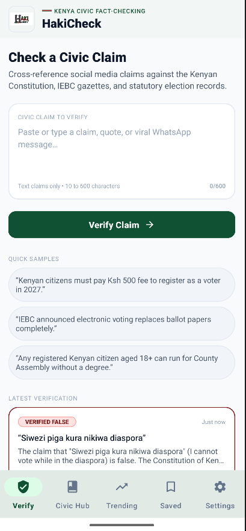
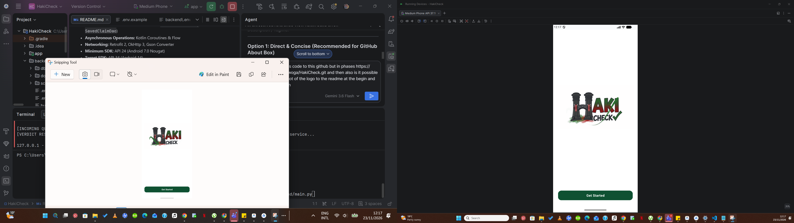
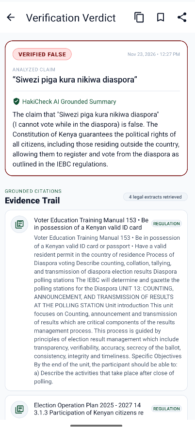
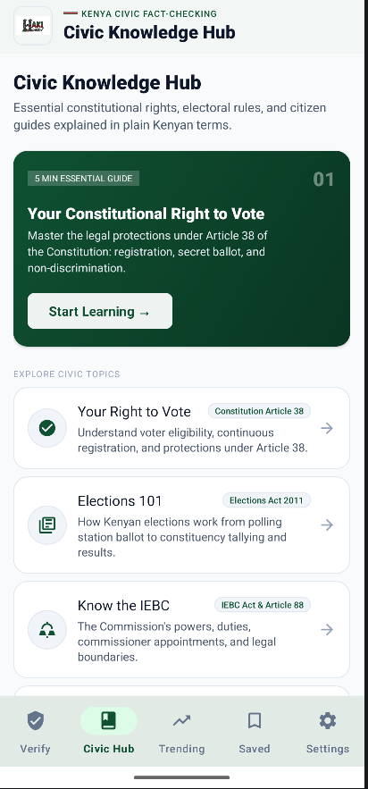

<p align="center">
  
</p>

<h1 align="center">HakiCheck</h1>

<p align="center">
  <b>AI-Powered Civic Fact-Checking Application for Kenya</b><br />
  Grounding social media claims and electoral rumors in official Kenyan legal statutes using Retrieval-Augmented Generation (RAG).<br />
  Supports English, Swahili, and Sheng.
</p>

---

## App Screenshots

<p align="center">
  
  &nbsp;
  
  &nbsp;
  
  &nbsp;
  
</p>

---

## 1. Project Overview

**HakiCheck** is a native Android application designed to help Kenyan citizens verify viral claims, news, and political rumors against authoritative legal and civic sources—including the **Constitution of Kenya 2010**, the **Elections Act No. 24 of 2011**, official **IEBC Gazettes**, and landmark **Supreme Court judgments**.

The platform aims to enhance information integrity and civic awareness by equipping voters with instant, grounded legal evidence and clear fact-check explanations.

### Key Features
* **Fact Verification Engine:** Input claims in English, Swahili, or Sheng to receive grounded evaluations backed by specific legal citations.
* **5-Tier Fact-Checking Taxonomy:** Categorizes claims into `VERIFIED TRUE`, `MOSTLY TRUE`, `MISLEADING`, `VERIFIED FALSE`, and `CIVIC INFO` / `UNVERIFIED`.
* **Explainable AI Evidence Trail:** Provides direct statutory snippets and citations (e.g., Articles of the Constitution or Sections of the Elections Act) explaining *why* a verdict was reached.
* **Civic Knowledge Hub:** Offers plain-language guides on political rights, voting procedures, electoral boundaries, and spotting disinformation.
* **Trending Claims Tracker:** Browse widely circulating claims and public rumors verified by the platform.
* **Offline Resilience:** Dual-mode support allowing the app to function via local embedded legal seed data when an internet connection or backend server is unavailable.
* **Save & Bookmark History:** Save verified claims to local device storage using Room database.
* **WhatsApp Share Formatter:** Easily format and share verified claims with friends or community groups.

---

## 2. System Architecture

```
┌─────────────────────────────────────────────────────────┐
│                 Native Android App (Client)             │
│   (Kotlin, MVVM, Material 3, ViewBinding, Room DB)      │
└────────────────────────────┬────────────────────────────┘
                             │  REST API (JSON)
                             ▼
┌─────────────────────────────────────────────────────────┐
│                 FastAPI RAG Server (Backend)            │
│  (Python, Vector Store, Embeddings, LLM / Legal Rules)  │
└────────────────────────────┬────────────────────────────┘
                             │
                             ▼
┌─────────────────────────────────────────────────────────┐
│                Kenyan Statutory Legal Corpus            │
│  (Constitution of Kenya 2010, Elections Act, eKLR, etc) │
└────────────────────────────┴────────────────────────────┘
```

---

## 3. Tech Stack

* **Language:** Kotlin
* **Architecture:** MVVM (Model-View-ViewModel) with Android Architecture Components (`ViewModel`, `LiveData`, `lifecycleScope`)
* **UI Framework:** Native Android Views, XML Layouts, Material Design 3 (`Theme.HakiCheck`), ViewBinding
* **Database / Persistence:** Room Database (`SavedClaimEntity`, `SavedClaimDao`)
* **Asynchronous Operations:** Kotlin Coroutines & Flow
* **Networking:** Retrofit 2, OkHttp 3, Gson Converter
* **Minimum SDK:** API 24 (Android 7.0 Nougat)
* **Target SDK:** API 34 (Android 14)

---

## 4. Project Structure

```
HakiCheck/
├── app/
│   ├── src/main/
│   │   ├── java/ke/co/hakicheck/
│   │   │   ├── data/
│   │   │   │   ├── local/          (Room DB, Entities, DAOs)
│   │   │   │   ├── remote/         (Retrofit Client, DTOs, API Service)
│   │   │   │   └── repository/     (FactCheckRepository, CivicRepository, OfflineSeedData)
│   │   │   ├── domain/model/       (ClaimVerification, VerdictType, EvidenceSource, CivicTopic)
│   │   │   └── presentation/ui/    (Verify, Knowledge, Trending, Saved, Settings)
│   │   └── res/                    (Layouts, Drawables, Values, Navigation Graph)
│   └── build.gradle.kts
├── docs/screenshots/               (App Screenshots & Logo)
├── Reference/                      (Project Deliverables, Exploratory Notebooks)
├── RAG_Final.ipynb                 (Final ML Engine Notebook)
├── build.gradle.kts
└── settings.gradle.kts
```

---

## 5. Getting Started

### Running the Android Application
1. Open **Android Studio**.
2. Select **File > Open** and choose the `HakiCheck` project directory.
3. Allow Gradle to synchronize dependencies.
4. Select an Android Emulator (API 24+) or a connected physical Android device.
5. Click **Run 'app'** (`Shift + F10`).

### Running the Backend (Optional for Live Mode)
1. Ensure Python 3.10+ is installed.
2. Navigate to the backend directory and install dependencies:
   ```bash
   pip install -r backend/requirements.txt
   ```
3. Start the FastAPI server:
   ```bash
   python backend/main.py
   ```
4. The server will run on `http://localhost:8000`. In the app settings, set the Server URL to `http://10.0.2.2:8000/` for Android Emulator or your local IP for physical devices.
